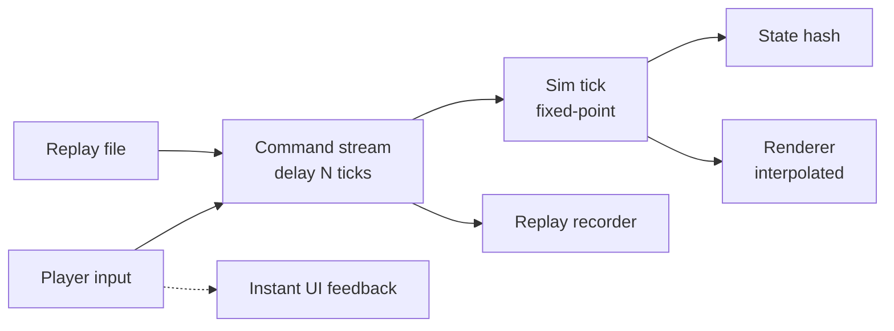

# Action Squad RPG: Gray-Box Prototype Spec

Status: draft 1, 2026-10-09

## 1. Purpose

The prototype answers one question:

> Is commanding a small squad in real time fun, in a browser, with lockstep-style input delay?

Anything that does not help answer that question is out of scope, with one exception: the deterministic simulation foundations are in, because they cannot be retrofitted later.

The prototype is throwaway in content and presentation. The sim core, the command stream and the replay system are expected to survive into the real game.

## 2. Target feel

- Tactics win the fight; micro decides by how much.
- Closer to StarCraft than to Neverwinter Nights: instant commands, no turn rates, no pseudo-turns.
- A player who only uses attack-move can finish. A player who focus-fires, kites, dodges and lands skillshots finishes in visibly better shape.
- Fights last long enough to read and react to (closer to Warcraft 3 than StarCraft in time-to-kill).

## 3. In scope

### 3.1 Simulation foundations

- Fixed-tick simulation, fully separate from rendering. The renderer interpolates between the last two sim states.
- Fixed-point arithmetic for all gameplay state. No floating point inside the sim.
- Every player action enters the sim as a command through a command stream with a configurable delay, so single-player already feels like the networked game.
- Input recording and replay: a replay is the initial seed plus the command stream.
- A state hash computed every tick, stored alongside the replay for divergence detection.
- A headless runner that plays a replay (or a scripted bot) with no window and prints the final hash and outcome.
- Two builds from the first day: one native desktop build for iteration and one browser build (WebAssembly). The same replay must produce the same hashes on both.

Determinism rules for sim code:

| Rule | Reason |
|---|---|
| No floats, no `<cmath>` | Results differ across compilers and platforms |
| Sim owns its seeded random generator | No hidden global state |
| No wall-clock time | Tick count is the only clock |
| No iteration over unordered containers | Order is implementation-defined |
| No ordering by pointer address | Addresses differ per run |
| Single-threaded sim | Removes scheduling as a variable |
| Entities processed in stable ID order | Same order on every machine |

### 3.2 Control

- Click selection, box selection, add/remove from selection.
- Control groups (assign and recall).
- Orders: move, attack-move, attack target, stop, hold position.
- Shift-queued orders.
- Targeted abilities (point, direction, unit) with smart-cast.
- Camera pan (edge and keys) and zoom.
- Instant client-side feedback for every order, independent of the command delay: selection rings, order markers, queued-path preview.

### 3.3 Movement

This is the most important system in the prototype and gets the largest share of effort.

- Grid-based pathfinding.
- Local steering and unit-to-unit avoidance with per-unit collision radius.
- Group movement that does not jam at chokepoints, dither at the destination, or leave stragglers taking absurd routes.
- Instant response to new move orders: no acceleration ramp, no turn rate.

### 3.4 Combat

- Auto-acquire targets in range; sensible default behaviour when idle.
- Attacks have a wind-up, a damage point and a cancellable backswing (this is what allows stutter-stepping).
- Projectiles travel in the world and can be dodged where the attack is designed for it.
- Health, damage, death. One resource-free cooldown ability per squad unit.

Squad (player-controlled):

| Unit | Role | Ability |
|---|---|---|
| Frontliner | Melee, high health, holds the line | Short taunt or shield |
| Marksman | Ranged sustained damage, fragile | Brief speed burst (kiting tool) |
| Support | Weak attack, keeps others alive | Targeted heal |
| Caster | Burst and area damage | Line or circle skillshot |

Enemies (AI-controlled):

| Unit | Behaviour | What it tests |
|---|---|---|
| Swarmer | Fast, weak, melee, comes in numbers | Frontline positioning, area damage |
| Shooter | Ranged, fragile, slow dodgeable projectile | Focus fire, dodging |
| Bruiser | Slow, tough, telegraphed area attack | Reading telegraphs, pulling units back |
| Bomber | Area damage on contact or death | Spreading out, target priority |

Enemy AI is limited to: idle, aggro on sight or damage, chase, attack, leash.

### 3.5 Content

- One hand-built map with three to five encounters of rising difficulty, built from walls, open areas and at least two chokepoints.
- Win condition: all encounters cleared. Lose condition: whole squad dead.
- Restart without relaunching.

### 3.6 Tooling

- All unit and ability stats in a data file with hot reload.
- Debug overlay: tick rate, command delay, per-unit stats, pathfinding and steering visualisation, pause and single-step.
- Replay save and load from the overlay.
- One scripted bot that plays the map using only attack-move, used as the baseline for exit criterion 2.

### 3.7 Presentation

- Primitive shapes only, colour-coded by unit type and team.
- Health bars, telegraph markers for area attacks, hit flashes, damage numbers, death pop.
- This minimal feedback is in scope because feel cannot be judged without it.

## 4. Out of scope

| Area | Excluded | Note |
|---|---|---|
| Networking | All of it | Second milestone; the command stream makes it an extension |
| Procedural generation | Maps, encounters, units | A content question; this prototype is about feel |
| Progression | Roster, leveling, items, permadeath, run structure | Decided after the prototype |
| Presentation | Art, animation, audio, menus, saves, settings | |
| Platforms | Mobile, touch, second and third desktop targets | One native build plus browser is enough |
| Engine generality | Asset pipeline, editor, scripting, generic entity framework | Build only what eight unit types need |
| Other systems | Fog of war, accounts, leaderboards | |
| Optimization | Anything beyond the performance target below | |

## 5. Starting values

All are first guesses and are expected to change during tuning.

| Parameter | Starting value |
|---|---|
| Sim tick rate | 30 per second |
| Command delay | 3 ticks (100 ms) |
| Squad size | 4 |
| Units on screen | About 50 |
| Performance target | Steady 60 fps in the browser build |
| Squad unit survival under focus by one encounter | 8 to 15 seconds |
| Swarmer survival under focus by the squad | 1 to 2 seconds |
| Full playthrough | 5 to 10 minutes |

## 6. Build order

1. **Sim skeleton.** Fixed tick, fixed-point types, command stream with delay, replay, state hash, headless runner, both builds. One unit that moves to a clicked point.
2. **Movement.** Pathfinding, steering, avoidance, group movement on the test map.
3. **Control.** Full selection and order set, queued orders, feedback.
4. **Combat.** Attacks, projectiles, abilities, the four squad units and four enemy types.
5. **Encounters and tuning.** Map, win and lose conditions, data file tuning, the attack-move bot.
6. **Evaluation** against the exit criteria.

Exit criterion 1 can be judged after step 3. If it fails there, fix movement before building combat.

## 7. Exit criteria

1. **Movement feel.** Moving the squad around an empty map is pleasant on its own: no jams, no dithering, no perceptible lag.
2. **Floor and ceiling.** The attack-move bot clears the map. A human who micros clears it with clearly more total health remaining, consistently across several runs.
3. **Determinism.** A five-minute replay ends on the same hash in the native and browser builds, with no per-tick divergence.

If 1 or 2 fail after tuning, the game concept needs rethinking before more engine work. If 3 fails, the problem is technical and must be fixed before the next milestone.

## 8. Open decisions

- Fixed-point format (for example 32-bit with 16 fractional bits and 64-bit intermediates) and map coordinate range.
- Pathfinding approach: per-unit A* versus flow fields for group orders.
- Platform layer and debug UI libraries.
- Rendering in flat 2D or simple 3D primitives with a fixed camera. The sim is 2D either way.
- Data file format.

## 9. Next milestone (not part of this prototype)

Two-player co-op over a relay server: each player controls their own squad, commands are exchanged per tick, and per-tick hashes are compared to detect desync.
